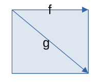
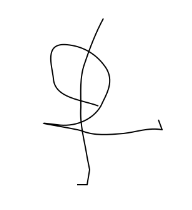

#### The Axiom of Light Prime Carre|Square

$(f±g)^{2'} = ((f±g).(f±g))^{'}$

$(f±g)^{2'} = (f±g)^{'}.(f±g)+(f±g).(f±g)^{'}$

$(f±g)^{2'} = f'f ± f'g ± g'f ± g'g ± ff' ± fg' ± gf' ± gg'$

$(f±g)^{2'} = 2f'f ± 2f'g ± 2g'g ± 2fg'$

$(f±g)^{2'} = 2.(f'f ± f'g ± g'g ± fg')$

if $f = \int_a^b g(x) \, dx$ and $g' = f$ and $g = \int_a^b f(x) \, dx$ and $f'=g$

$(f±g)^{2'} = 2.(f'\int_a^b f'(x) \, dx ± g'\int_a^b g'(x) \, dx) ± fg' ± f'g$

$(f±g)^{2'} = 2.(fg ± gf ± fg' ± f'g)$

$(f±g)^{2'} = 2.(f'g ± 2fg ± fg')$

carre prime {2'} the new math symbol of the Axiom is:

By Chems eddine, h1t8re 6.2.1996 After Jesus Christ'e
